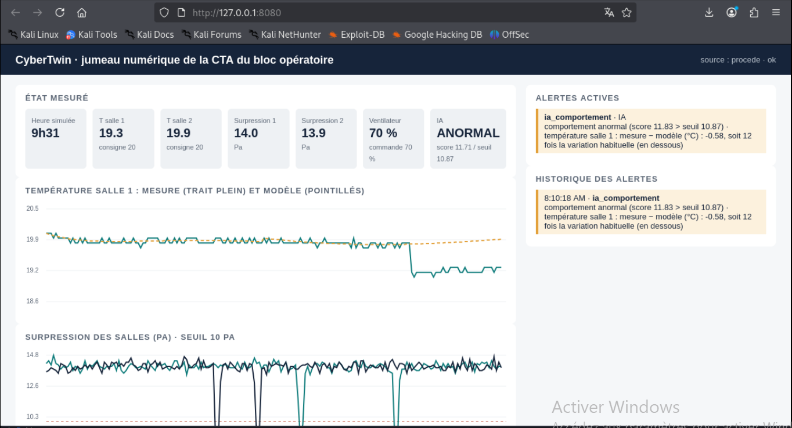
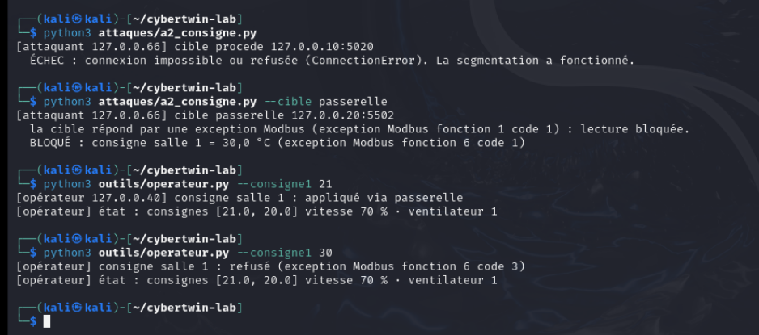
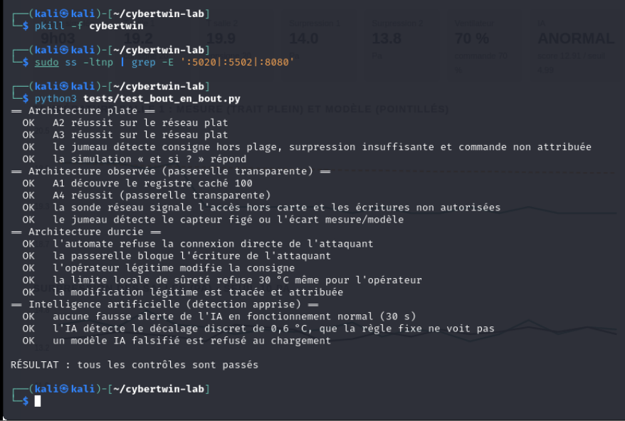

# CyberTwin · jumeau numérique de cybersécurité (OT / Modbus)

Projet de travaux pratiques du Master 2 Cybersécurité (module Technologies avancées, jumeau numérique).

Ce lab construit, puis attaque, le **jumeau numérique** de la centrale de traitement d'air (CTA) qui ventile deux salles d'opération d'un établissement hospitalier fictif. L'automate simulé parle le vrai protocole industriel **Modbus TCP**. Le jumeau lit l'automate chaque seconde, recalcule avec son propre modèle ce que les salles devraient faire, compare les deux et alerte en cas d'écart. On y ajoute une détection par intelligence artificielle, puis on durcit l'architecture jusqu'à bloquer les attaques.

Tout tourne en local, sur une seule machine. Chaque composant (automate, passerelle, jumeau, poste opérateur, poste pirate) a sa propre adresse de bouclage 127.0.0.x, comme s'il était sur une machine distincte d'un réseau hospitalier.

> Le code du kit pédagogique n'est pas publié ici, car c'est du matériel de cours protégé. Ce dépôt contient mon compte rendu, le détecteur que j'ai écrit, et les captures qui documentent le travail.

## Pourquoi ce projet

Un bloc opératoire est maintenu en **surpression** : l'air y est plus poussé que dans le couloir, pour que les poussières et les microbes n'entrent pas. Cette surpression est produite par une ventilation pilotée par un automate industriel. Si cette ventilation est sabotée, la surpression tombe et la salle peut être contaminée en quelques secondes. Le problème, c'est que ces automates ont été conçus pour un monde où le réseau était supposé sûr. Trois faiblesses en découlent, et le lab les traite une par une.

- **L'automate obéit à tout le monde.** Le protocole Modbus ne demande aucun mot de passe. N'importe quel ordinateur qui joint l'automate peut lui donner des ordres : changer une consigne de température, arrêter le ventilateur.
- **Les écrans peuvent mentir.** Le poste de conduite affiche ce que l'automate lui dit. Si un attaquant fige ou décale discrètement un capteur, l'écran reste au vert pendant que la salle dérive réellement.
- **On ne peut pas faire d'essais.** Impossible d'arrêter la ventilation d'un vrai bloc pour mesurer combien de temps tient la surpression. Les équipes doivent donc décider en pleine crise, sans avoir jamais pu tester.

Le jumeau numérique répond à ces trois problèmes : il voit quand les écrans mentent, il permet de savoir qui a donné un ordre, et il simule des pannes sans jamais toucher à l'installation.

## Comment fonctionne le jumeau

Le jumeau lit l'automate chaque seconde, mais il ne se contente pas de répéter ce qu'il lit. Il possède son **propre modèle physique** de la ventilation. À partir des seuls ordres réellement donnés (consigne de température, vitesse du ventilateur, marche ou arrêt), il calcule de son côté ce que la température et la pression devraient devenir. Puis il compare ce calcul à la mesure.

Le point important est là : **le jumeau fait confiance aux ordres, pas aux capteurs.** Si la mesure affiche 19,9 °C alors que le modèle prévoit 21,5 °C, il y a un problème, même si l'écran paraît normal. Pour éviter qu'un attaquant ne le trompe en contaminant petit à petit son modèle, le jumeau ne se recale sur le réel que lorsqu'aucune alerte n'est active.

Il offre aussi une fonction de simulation « et si ? ». En moins d'une seconde, et sans toucher à l'installation, il calcule ce que deviendrait la salle si le ventilateur s'arrêtait maintenant. Dans mes essais, la réponse était nette : la surpression tombe sous le seuil de sécurité en 20 secondes, et la salle dépasserait 24 °C pendant près de 25 minutes. Une cellule de crise connaît ainsi le délai dont elle dispose.

## Les cinq couches de détection

Le jumeau ne mise pas sur un seul détecteur. Il en empile plusieurs, sur des couches différentes, et c'est leur croisement qui démasque une attaque. Une attaque qui sait contourner une couche se fait prendre par une autre.

- **Couche réseau (la sonde de la passerelle).** Elle voit qui parle, quoi, et signale les accès hors de la carte documentée. C'est elle qui donne l'attribution, c'est-à-dire l'adresse de l'attaquant.
- **Couche commande.** Tout changement de réglage qui n'a pas d'écriture légitime tracée est suspect. Un ordre sans auteur connu est le signe d'une intrusion.
- **Couche modèle.** Elle compare la mesure au calcul physique, et repère aussi un capteur figé (une valeur parfaitement constante, ce qui n'arrive jamais en vrai).
- **Couche métier.** Les règles propres au bloc opératoire : consigne hors de la plage 18 à 26 °C, surpression sous 10 Pa.
- **Couche IA.** Un écart statistique par rapport à la normalité apprise, qui attrape ce que les règles fixes laissent passer.

## La détection par intelligence artificielle

L'IA ne connaît aucune règle écrite. Elle observe d'abord le fonctionnement normal pendant deux minutes et en fait un profil statistique. Elle surveille cinq indicateurs : les écarts entre mesure et modèle des deux températures, des deux surpressions, et de la puissance électrique. Pendant l'apprentissage, elle retient leur moyenne, leur dispersion habituelle, et surtout la façon dont ils varient ensemble.

Ensuite, à chaque mesure, elle calcule une distance à la normalité (une distance de Mahalanobis), appelée score. Comme cette distance tient compte des corrélations, l'IA peut repérer une valeur qui semble normale prise isolément mais qui casse une corrélation attendue. Son seuil d'alerte n'est pas fixé à la main : elle le calcule elle-même à partir des distances vues pendant l'apprentissage. Quand elle alerte, elle indique l'indicateur qui contribue le plus à l'écart.

C'est ce qui lui permet de voir une attaque trop fine pour les règles. Dans le lab, un décalage de température de 0,6 °C passe sous le seuil de toutes les règles (la règle d'écart modèle n'alerte qu'à 0,8 °C), mais représente douze fois la variation habituelle pour l'IA, qui alerte aussitôt.

L'IA a toutefois deux limites, que le lab démontre concrètement. D'abord, si l'attaque est présente **pendant** l'apprentissage, l'IA l'apprend comme étant normale et devient aveugle : c'est l'empoisonnement de données. La parade est de charger un modèle validé hors ligne, dans des conditions saines, au lieu d'apprendre en direct sur une installation peut-être déjà compromise. Ensuite, ce modèle de référence est signé : si quelqu'un modifie le fichier (par exemple pour gonfler le seuil et aveugler l'IA), le jumeau recalcule l'empreinte, voit qu'elle ne correspond plus, et refuse de charger le modèle.

## Les attaques jouées

| Code | Attaque | Ce qu'elle exploite |
|---|---|---|
| A1 | Reconnaissance | Balayage de tous les registres, découverte du registre caché 100 |
| A2 | Sabotage de consigne | Écriture Modbus sans authentification (consigne à 30 °C) |
| A3 | Arrêt du ventilateur | Écriture de bobine, perte de la surpression du bloc |
| A4 | Capteur figé | Registre caché 100, l'écran ment pendant que la salle chauffe |
| A6 | Décalage discret | Décalage de 0,6 °C sous le seuil des règles, visible par l'IA seule |

La reconnaissance (A1) ne sabote rien : elle balaie l'automate pour voir ce qui existe, y compris un registre de maintenance 100 absent de la documentation. C'est souvent la première phase d'une vraie attaque. Le sabotage de consigne (A2) et l'arrêt du ventilateur (A3) sont des attaques franches, dont on voit l'effet immédiatement. Le capteur figé (A4) est plus sournois : il utilise le registre caché pour bloquer une mesure tout en gardant une consigne dans la plage autorisée, pour que l'écran paraisse normal. Le décalage discret (A6) pousse la discrétion à l'extrême, et n'est visible que par l'IA.

## Les trois architectures

Le même jeu d'attaques est rejoué dans trois architectures réseau différentes, pour montrer la différence entre détecter et protéger.

| | Réseau plat | Observé | Durci |
|---|---|---|---|
| Protection | aucune | passerelle transparente | segmentation + filtrage + sûreté locale |
| Attaques | réussissent, auteur inconnu | réussissent, mais attribuées | bloquées |
| Rôle du jumeau | voit les effets | voit et attribue | la protection vient de l'architecture |

En **réseau plat**, le jumeau parle directement à l'automate. Les attaques réussissent toutes, le jumeau voit chaque effet, mais il ne peut pas dire qui a donné l'ordre : l'attaquant reste anonyme.

En **architecture observée**, on ajoute une passerelle devant l'automate. Tout le monde passe par elle, elle note chaque requête avec l'adresse de l'émetteur. Les attaques réussissent toujours, mais chacune est désormais attribuée à l'ordinateur du pirate. On sait enfin qui agit.

En **architecture durcie**, trois barrières s'ajoutent. La **segmentation** : l'automate n'accepte plus que la passerelle, l'attaque directe est refusée au niveau réseau. Le **filtrage** : la passerelle bloque les écritures qui ne viennent pas du poste opérateur. La **sûreté locale** : l'automate refuse de lui-même toute valeur dangereuse, même venant d'une source autorisée. Les deux premières barrières arrêtent les intrus, la troisième arrête aussi les erreurs humaines (un opérateur légitime qui taperait 30 °C par erreur est refusé).

## Ma contribution : le détecteur de cohérence puissance / vitesse

À l'étape 14 du lab, j'ai écrit mon propre détecteur et je l'ai ajouté au jumeau. Son principe est purement physique : la puissance électrique consommée par le ventilateur dépend de sa vitesse, selon la relation `puissance = 2,0 + 0,06 x vitesse` (en kilowatts). Mon détecteur recalcule la puissance attendue à partir de la vitesse mesurée, et la compare à la puissance réellement mesurée. Si l'écart dépasse 1 kilowatt, l'une des deux valeurs est truquée, et il lève une alerte.

Pour le tester, j'ai aussi ajouté dans l'automate le mode caché qui fige la puissance (registre 100 à 2), puis j'ai arrêté le ventilateur. La vitesse réelle est tombée, mais la puissance est restée figée à 6,2 kW : les deux ne sont plus cohérentes, et mon détecteur se déclenche. Il attrape ainsi une attaque qu'aucune règle d'origine ne voyait. Le code se trouve dans `detecteur_puissance_vitesse.py`.

## Aperçu en images

Sabotage de la consigne sur le réseau plat (A2) : la consigne passe à 30 °C, la température grimpe, le jumeau alerte mais ne peut pas nommer l'auteur.

Capteur figé (A4) derrière la passerelle : la mesure reste plate, le modèle monte, et six détecteurs démasquent le mensonge en même temps.

L'attaque que seule l'IA voit (A6) : un décalage de 0,6 °C passe sous toutes les règles fixes, mais sort du profil appris par l'IA, qui alerte.

Architecture durcie : attaque directe refusée, attaque par la passerelle bloquée, et même une consigne dangereuse de l'opérateur légitime est refusée par la sûreté locale.

Mon détecteur de cohérence puissance / vitesse en action (étape 14) : il attrape une attaque qu'aucune règle d'origine ne voyait.

Vérification automatique finale : les seize contrôles passent sur les trois architectures et sur l'IA, mes deux modifications comprises.

## Ce que je retiens

Trois idées structurent ce lab. D'abord, un jumeau qui calcule au lieu de croire les capteurs voit quand les écrans mentent, parce qu'il confronte la mesure à un modèle physique et au trafic réseau. Ensuite, une IA qui apprend la normalité complète les règles en repérant les attaques trop discrètes, mais elle a ses propres faiblesses, l'empoisonnement de son apprentissage en tête, auxquelles on répond par un modèle validé hors ligne et signé. Enfin, et c'est la leçon principale : détecter ne suffit pas. Tant qu'une attaque réussit, le danger demeure. C'est l'architecture, par la segmentation, le filtrage et la sûreté locale, qui transforme la détection en protection.

La phrase à retenir : **le jumeau détecte, l'architecture protège.**

## Contenu du dépôt

- `README.md` : cette présentation.
- `docs/Compte_rendu_TP_jumeau_numerique.pdf` : compte rendu complet, les 15 étapes avec captures et analyse.
- `detecteur_puissance_vitesse.py` : le détecteur de cohérence puissance / vitesse que j'ai ajouté au jumeau.
- `docs/img/` : les captures d'écran du travail.

## Stack technique

Python 3 (bibliothèque standard uniquement), Modbus TCP, SQLite, tableau de bord HTML, Wireshark et tshark pour l'observation du trafic. Réalisé sous Kali Linux (VMware).
