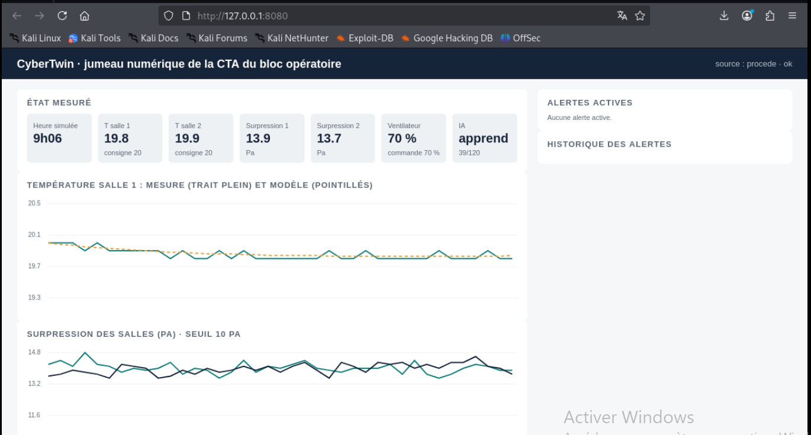
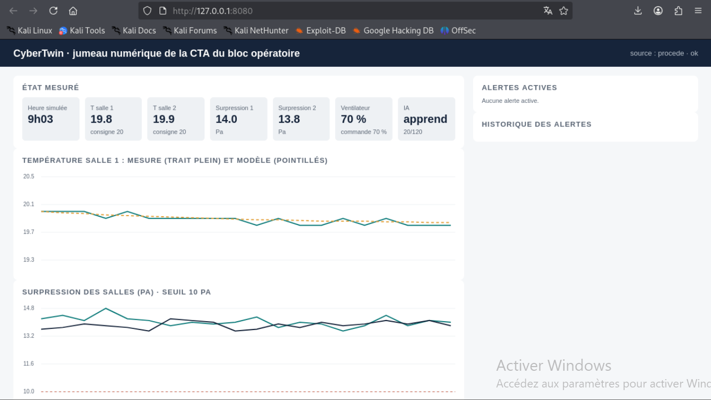
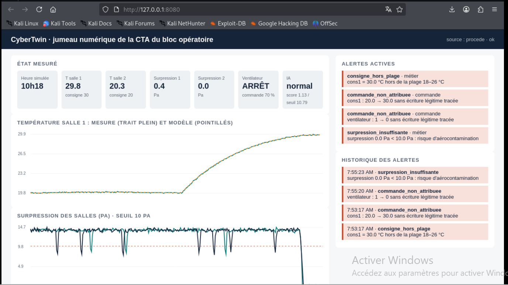
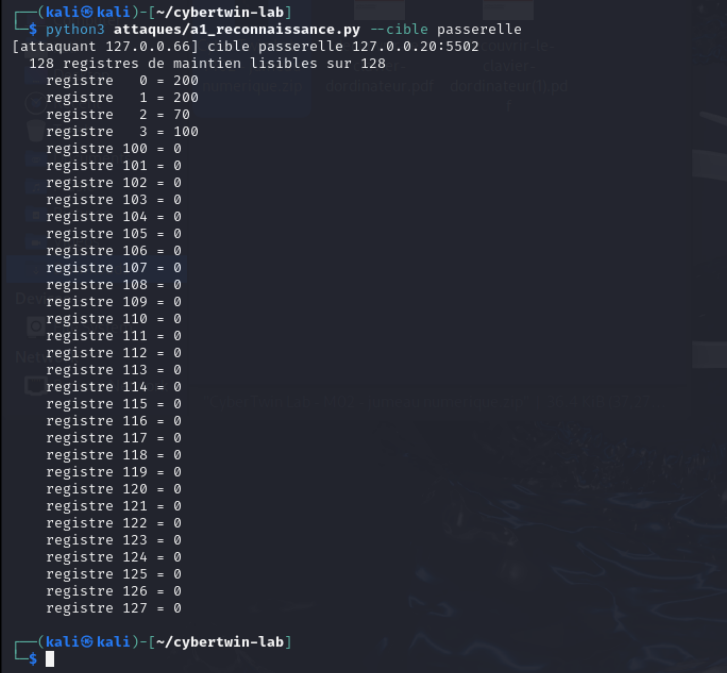
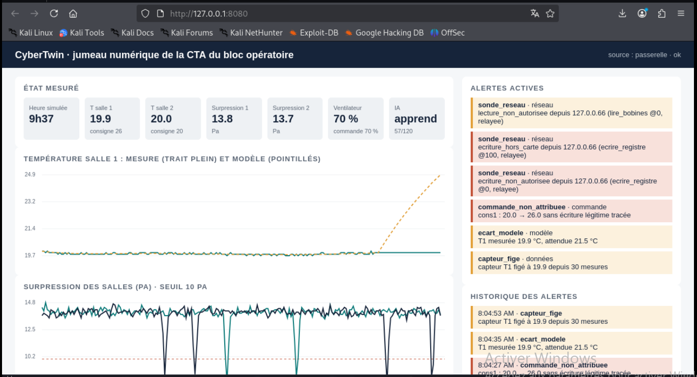
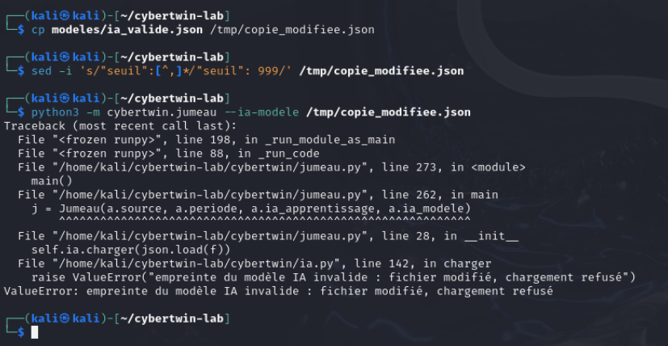
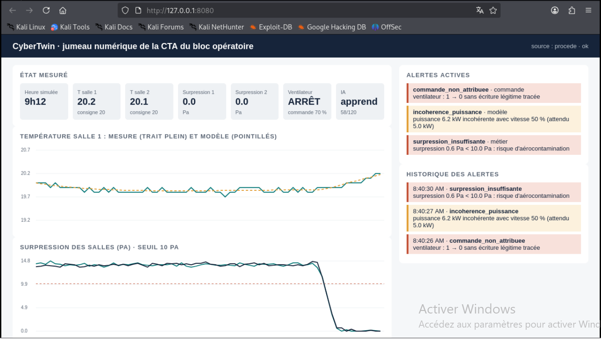

# CyberTwin · jumeau numérique de cybersécurité (OT / Modbus)

Projet de travaux pratiques du Master 2 Cybersécurité (module Technologies avancées, jumeau numérique).

Ce lab construit, puis attaque, le **jumeau numérique** de la centrale de traitement d'air (CTA) qui ventile deux salles d'opération d'un établissement hospitalier fictif. L'automate simulé parle le vrai protocole industriel **Modbus TCP**. Le jumeau lit l'automate chaque seconde, recalcule avec son propre modèle ce que les salles devraient faire, compare les deux et alerte en cas d'écart. On y ajoute une détection par intelligence artificielle, puis on durcit l'architecture jusqu'à bloquer les attaques.

> Le code du kit pédagogique n'est pas publié ici, car c'est du matériel de cours protégé. Ce dépôt contient mon compte rendu, le détecteur que j'ai écrit, et les captures qui documentent le travail.

## Pourquoi ce projet

Un bloc opératoire est maintenu en surpression : l'air y est plus poussé que dans le couloir, pour que les poussières et les microbes n'entrent pas. Cette surpression est produite par une ventilation pilotée par un automate industriel. Si la ventilation est sabotée, la surpression tombe et la salle peut être contaminée en quelques secondes. Or ces automates ont été conçus pour un monde où le réseau était supposé sûr. Trois faiblesses en découlent, et le lab les traite une par une : l'automate obéit à tout le monde (Modbus ne demande aucun mot de passe), les écrans peuvent mentir (un capteur figé laisse l'écran au vert pendant que la salle dérive), et on ne peut pas faire d'essais sur une vraie installation.

## Comment fonctionne le jumeau

Le jumeau lit l'automate chaque seconde, mais il ne répète pas ce qu'il lit. Il possède son propre modèle physique de la ventilation. À partir des seuls ordres réellement donnés (consigne, vitesse, marche ou arrêt), il calcule de son côté ce que la température et la pression devraient devenir, puis il compare ce calcul à la mesure. Le point clé est là : **il fait confiance aux ordres, pas aux capteurs.** Si la mesure affiche 19,9 °C alors que le modèle prévoit 21,5 °C, il y a un problème, même si l'écran paraît normal.

Sur le tableau de bord ci-dessus, le trait plein est la mesure et les pointillés sont le calcul du jumeau. En temps normal, les deux se suivent. Le jumeau sait aussi simuler : en moins d'une seconde, et sans toucher à l'installation, il calcule qu'un arrêt du ventilateur ferait tomber la surpression sous le seuil de sécurité en 20 secondes.

## Phase 1 et 2 : de la normalité aux premières attaques

Sur le réseau plat, sans aucune protection, un ordinateur compromis peut écrire directement dans l'automate. Le sabotage de consigne (A2) porte la température demandée à 30 °C : la salle se met à chauffer, le jumeau alerte sur une consigne hors plage et sur un changement sans ordre légitime, mais il ne peut pas dire qui a agi.

L'arrêt du ventilateur (A3) est plus brutal. La surpression des deux salles plonge sous la ligne des 10 Pa, le bloc n'est plus protégé contre l'air du couloir. On voit en direct ce que la simulation avait prédit, et une alerte de risque d'aérocontamination apparaît.

## Phase 3 : savoir qui donne les ordres

On ajoute une passerelle devant l'automate. Tout le monde passe par elle, et elle note chaque requête avec l'adresse de l'émetteur. La reconnaissance (A1) balaie alors les 128 registres de l'automate et découvre au passage un registre de maintenance 100, absent de toute documentation : c'est la porte dérobée que les attaques suivantes exploiteront.

Le capteur figé (A4) est l'attaque la plus sournoise. Elle utilise le registre caché pour bloquer la mesure de température, tout en gardant une consigne dans la plage autorisée, pour que l'écran reste crédible. Mais le jumeau croise plusieurs sources : la mesure reste plate pendant que son modèle monte, et six détecteurs se déclenchent en même temps, sur trois couches différentes (réseau, commande, modèle).

## Phase 4 : l'intelligence artificielle

L'IA ne connaît aucune règle. Elle observe le fonctionnement normal pendant deux minutes, surveille cinq écarts entre mesure et modèle (dont la puissance électrique), et apprend leur comportement habituel. Ensuite, elle calcule une distance à la normalité, et alerte dès qu'une mesure s'en écarte trop. Cela lui permet de voir des attaques trop fines pour les règles : un décalage de 0,6 °C passe sous le seuil de toutes les règles fixes, mais représente douze fois la variation habituelle pour elle.

L'IA a deux limites, démontrées dans le lab. Si l'attaque est présente pendant l'apprentissage, elle l'apprend comme normale (empoisonnement de données). La parade est un modèle validé hors ligne, dans des conditions saines. Et ce modèle est signé : un fichier modifié pour aveugler l'IA est refusé au chargement, car son empreinte ne correspond plus.

## Phase 5 : protéger

L'architecture durcie ajoute trois barrières. La segmentation : l'automate n'accepte plus que la passerelle, l'attaque directe est refusée au niveau réseau. Le filtrage : la passerelle bloque les écritures qui ne viennent pas du poste opérateur. La sûreté locale : l'automate refuse les valeurs dangereuses, même d'une source autorisée. Les deux premières arrêtent les intrus, la troisième arrête aussi les erreurs humaines.

## Ma contribution : le détecteur puissance / vitesse

À l'étape 14, j'ai écrit mon propre détecteur. Son principe est physique : la puissance du ventilateur dépend de sa vitesse, selon `puissance = 2,0 + 0,06 x vitesse` (kW). Mon détecteur recalcule la puissance attendue à partir de la vitesse mesurée, et alerte si l'écart dépasse 1 kW. Pour le tester, j'ai figé la puissance (registre 100 à 2) puis arrêté le ventilateur : la vitesse tombe, la puissance reste figée, les deux ne sont plus cohérentes. Mon détecteur attrape ainsi une attaque qu'aucune règle d'origine ne voyait. Le code est dans `detecteur_puissance_vitesse.py`.

Enfin, le test automatique fourni rejoue seul les trois architectures et l'IA, et vérifie seize points. Il passe en entier, mes deux modifications comprises.

## Les attaques jouées

| Code | Attaque | Ce qu'elle exploite |
|---|---|---|
| A1 | Reconnaissance | Balayage de tous les registres, découverte du registre caché 100 |
| A2 | Sabotage de consigne | Écriture Modbus sans authentification (consigne à 30 °C) |
| A3 | Arrêt du ventilateur | Écriture de bobine, perte de la surpression du bloc |
| A4 | Capteur figé | Registre caché 100, l'écran ment pendant que la salle chauffe |
| A6 | Décalage discret | Décalage de 0,6 °C sous le seuil des règles, visible par l'IA seule |

## Les trois architectures

| | Réseau plat | Observé | Durci |
|---|---|---|---|
| Protection | aucune | passerelle transparente | segmentation + filtrage + sûreté locale |
| Attaques | réussissent, auteur inconnu | réussissent, mais attribuées | bloquées |
| Rôle du jumeau | voit les effets | voit et attribue | la protection vient de l'architecture |

## Ce que je retiens

Un jumeau qui calcule au lieu de croire les capteurs voit quand les écrans mentent. Une IA qui apprend la normalité complète les règles, mais reste vulnérable à l'empoisonnement, d'où le modèle validé et signé. Et surtout, détecter ne suffit pas : tant qu'une attaque réussit, le danger demeure. C'est l'architecture qui transforme la détection en protection.

La phrase à retenir : **le jumeau détecte, l'architecture protège.**

## Contenu du dépôt

- `README.md` : cette présentation.
- `docs/Compte_rendu_TP_jumeau_numerique.pdf` : compte rendu complet, les 15 étapes avec captures et analyse.
- `detecteur_puissance_vitesse.py` : le détecteur de cohérence puissance / vitesse ajouté au jumeau.
- `docs/img/` : toutes les captures d'écran du travail.

## Stack technique

Python 3 (bibliothèque standard uniquement), Modbus TCP, SQLite, tableau de bord HTML, Wireshark et tshark pour l'observation du trafic. Réalisé sous Kali Linux (VMware).
